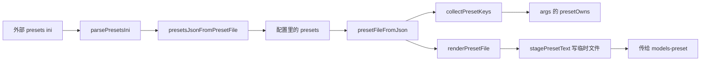

# 06 模型预设的 JSON 化

> **本章目标**：搞懂「每个模型一套参数」这件事的数据结构，以及为什么它从一份外部 `presets.ini`
> 搬进了配置文件的 `presets` 字段 —— 而且 ini 并没有消失，只是降级成了「给服务器看的中间产物」。
> **主要文件**：`src/core/presets.ts`、`src/core/launcher.ts`、`src/test/presets.test.ts`。
> 文中行号按编辑器口径（末行不以换行结尾）。
> **前置**：[05 参数拼装与决策表](./05-参数拼装与决策表.md)、[03 配置与数据模型](./03-配置与数据模型.md)。

## 0. 学完这章你能回答什么

- 为什么 `llama-launcher.json` 里要有一张「模型名 → 参数表」，而不是给所有模型用同一套参数？
- 一份 ini 是怎么被解析成内存结构的？`[defaults]` 段凭什么能被当配置读，而服务器又看不到它？
- 迁移到 JSON 到底解决了哪三个真实麻烦？（提示：一个关于路径，一个关于假模型，一个关于「改两个文件」）
- `presetFileFromJson` 和 `presetsJsonFromPresetFile` 名字这么像，为什么两个都要有？
- `n-predict` 那个「按模型推导」的公式是什么？边界在哪？

## 1. 先看问题

llama-server 的 router 模式（见 [01 认识 llama.cpp 与启动器](./01-认识-llama-cpp-与启动器.md)）一次注册一整个目录的
模型，请求里写哪个模型名就热切换哪个。听起来很美，但有个现实问题：**这几个模型想要的参数完全不同**。

看你机器上真实的那份 [presets.ini](../../../一键启动脚本/presets.ini)（只读样本，共 81 行）。
它的 27B 档（`一键启动脚本/presets.ini:40-46`）是 `ctx-size = 16384`、`cache-type-k = q4_0`、
`cache-type-v = q4_0`、`fit-target = 1024`、`load-mode = mmap+mlock`、`threads = 6`；
而小模型档（`一键启动脚本/presets.ini:59-65`）把 `ctx-size` 放到 `32768`、KV 改成 `q8_0`。
同一批键、不同的值，注释里写着理由：

```ini
; 一键启动脚本/presets.ini:34-37
; 27B 大模型 —— 16G 显存下按"尽量多上卡"配置（实测 7~10 tok/s）
;   ctx 16384 收紧（原生 256K 太吃 KV）；KV 用 q4_0 减半；
;   fit-target 1024 多留 1G 给权重上卡；mlock 防换页。
;   想要更激进（约 9.8 tok/s）：ctx-size 改 8192，fit-target 改 512，
```

**没有预设会怎样？** 三个麻烦，一个比一个烦：

1. **上下文长度（`-c`）是显存大户。** KV cache 的量级由它决定，27B 模型想把窗口开大就得压 KV 量化（`cache-type-k = q4_0`），
   而 8B 模型显存富裕，可以保质量用 `q8_0`。同一套值不可能同时对。
2. **显存分层（`fit-target` / `-ngl`）同一个数在不同模型上后果不同**：27B 挤 16G 得留 1G 余量，小模型随便上卡。
3. **最关键的是**：这些参数**不能靠命令行一次性传**。命令行是全局的，你传 `-c 32768`，切到 27B 也一样是 32768 —— 而 27B 撑不住。

所以预设的定位很明确：**一张「按模型覆盖参数」的表**，服务器切换模型时自己去查。

而这张表历史上是一份**外部 ini 文件**（你现在还能在 `一键启动脚本\presets.ini` 看到它），
后来被搬进了配置 JSON。这一章的主线就是这个搬迁：**为什么搬、怎么搬、搬完之后那份 ini 去哪了**。

## 2. 核心概念

### 模型预设

**是什么**：给某个模型覆盖的一组启动参数，键名沿用 llama.cpp `--models-preset` 自己的名字。

**为什么需要**：上一节说的三条。注意它和命令行不是二选一，而是**分层**的 —— 全局的用命令行，per 模型的用预设。

**本项目里在哪**：配置字段 `LauncherConfig.presets`，类型是「模型名 → 参数表」
（`src/core/types.ts:139`）：

```ts
// src/core/types.ts:139
  presets?: Record<string, Record<string, string | number | boolean>>;
```

该字段上方 10 行的注释（`src/core/types.ts:128-138`）解释了三条约定：键名沿用 llama.cpp
`--models-preset` 自己的键、**不做我们自己的翻译**（免得 llama.cpp 加键还要改代码）、
段名 = 模型名（GGUF 文件名去掉 `.gguf`），以及「启动器自己的 `default-model` 约定不放这里」。

真实的一份长这样（仓库根目录那份配置；下面把该模型段的一行行键值折成两行显示，
逐字内容见 `llama-launcher.json:6-13`）：

```json
// llama-launcher.json:7-13（原文件每行一个键，这里为省篇幅合并显示；键与值逐字未改）
      "ctx-size": 16384, "cache-type-k": "q4_0", "cache-type-v": "q4_0",
      "fit-target": 1024, "load-mode": "mmap+mlock", "threads": 6, "n-predict": 8192
```

### `PresetFile`：夹在中间的内存结构

**是什么**：一个只用于「读」和「渲染」的中间形态，三个字段：分段表、预加载模型名、原始键名。

```ts
// src/core/presets.ts:32-39
export interface PresetFile {
  /** 段落名 → 键值（键名统一小写，取原始键名时用 rawKeys） */
  sections: Map<string, Map<string, string>>;
  /** [defaults] 段里的 default-model（注释形式也认）；对应配置里的 `preload_model` */
  defaultModel: string | null;
  /** 各段出现的键名原始大小写，用于展示 */
  rawKeys: Map<string, string[]>;
}
```

**为什么需要**：ini 和 JSON 的**键名大小写语义**不一样 —— ini 里键名大小写不敏感（`Ctx-Size` 和 `ctx-size` 是一回事），
JSON 里键名是**字面量**。所以内部统一用小写 `Map` 做查找，另外把「用户当初写的原始大小写」存进 `rawKeys`，
渲染回 ini 时还原回去。

**本项目里在哪**：`src/core/presets.ts` 全文；所有函数都围绕它转一圈。

### 为什么从 ini 迁到 JSON（本章主线）

**是什么**：预设的**存储位置**从外部 ini 换成了配置里的一个 JSON 字段，ini 退化成「启动时现渲染、写到 `%TEMP%`、只给服务器看」的中间产物。

**为什么需要**：一句代码注释把前两个理由都写了（`src/core/presets.ts:11-15`）：一是
「`--models-preset` 传非 ASCII 路径会让 llama-server 刷两行日志后崩退 —— 现在路径由我们自己生成在 `%TEMP%`，
不可能带中文」；二是「`[defaults]` 段会被服务器当成一个名叫 defaults 的假模型 —— 现在这份 ini 由我们生成，
根本不会写出这样的段」。第三个理由在使用层面：**改配置要改两个文件** —— 预设写在 ini 里、其他参数写在
`llama-launcher.json` 里，想给一个模型调参得先想清楚「这个键该放哪」；导入之后所有东西都在一份配置里。

**本项目里在哪**：`src/core/presets.ts:1-22` 的文件头注释；README 的「模型预设：写在配置里」一节（`README.md:293-351`）。

### `default-model` 与 `preload_model`

**是什么**：一对历史约定和它的新家。

**为什么需要**：老 ini 的 `[defaults]` 段里有一行**注释** `; default-model = Qwen3.8-27B-Uncensored-IQ4_XS`
（`一键启动脚本\presets.ini:31`）。它不能写成正式的键 —— 因为服务器不认自定义键、会直接退出
（原因写在 `一键启动脚本\presets.ini:23-26`），所以只能靠脚本「把注释当配置读」。
但注释终究是脚本的方言，启动器给了它一个正式字段 —— 配置里的 `preload_model`；
旧的 `models_preset` 路径字段则只剩「导入」用途：

```ts
// src/core/types.ts:141-147（节选）
   * 旧的 presets.ini 路径，**仅用于导入**。
   *
   * 早先这个路径会被原样传给 `--models-preset`，带来两个麻烦：中文路径会让 llama-server 崩退
   * （必须每次转存到 %TEMP%）、`[defaults]` 段会被服务器当成一个假模型。
   * 现在预设以 {@link LauncherConfig.presets} 为准；这个字段只在 presets 为空时用来做一次性导入。
  models_preset?: string;
```

**本项目里在哪**：配置字段 `preload_model`（`src/core/types.ts:150-151`）；读出来填进去的地方在
`src/core/presets.ts:92-94`（解析）和 `src/main/session.ts:339-341`、`src/main/session.ts:372-374`（落配置）。

### 键名并集与 `presetOwns`

**是什么**：把「所有模型段出现过的键」收集成一个并集，凡是落在并集里的键，命令行**就不再传**。

**为什么需要**：实测（注释里写明了）命令行优先级高于 preset —— 传了反而会盖掉预设里按模型调好的值。

**本项目里在哪**：`collectPresetKeys`（`src/core/presets.ts:118-125`）→ `prepareLaunch` 传给 `buildArgs`
（`src/core/launcher.ts:292`）→ `presetOwns`（`src/core/args.ts:220-221`）。这条链路是本章和第 05 章的交界，第 3.6 节展开。

## 3. 代码怎么走

先用一张图看清两个方向：**主路径**（配置 → 临时 ini → 服务器）和**导入路径**（ini → 配置）。



### 3.1 `parsePresetsIni`：把一个 ini 读成内存结构

它的契约写在注释里（`src/core/presets.ts:49-62`），六条容忍的写法逐条对应下面的代码：
兼容 CRLF / LF 与 BOM；键名统一转小写、原始大小写另存 `rawKeys`；键值行允许以 `;` 或 `#` 开头；
段头之前的行被忽略；`[defaults]` 段只提取 `default-model`；**解析失败的行静默跳过，永不抛异常**。

主循环只有三十行，但每一行都在处理上面某条边界。**注意第一行的 `stripBom`**：

```ts
// src/core/presets.ts:69-84（主循环开头：切行 → trim → 判段头）
  for (const rawLine of stripBom(text).split(/\r?\n/)) {
    // 注意：先 trim 再判注释 —— [defaults] 段的 default-model 约定就是写在注释里
    const line = rawLine.trim();
    if (line === "") continue;

    const sec = /^\[(.+?)\]$/.exec(line);
    if (sec && sec[1]) {
      current = sec[1];
      if (!sections.has(current)) {
        sections.set(current, new Map());
        rawKeys.set(current, []);
      }
      continue;
    }

    if (current === null) continue;
```

- `^\[(.+?)\]$` 就是「段名 = 模型名」这条规则的落点；`current === null` 时直接跳过 —— 「段头之前的行会被忽略」；
- `stripBom`（`src/core/presets.ts:45-47`）在**切行之前**剥掉 BOM，否则第一行的段头会带上一个不可见字符而匹配不上；
- `.split(/\r?\n/)` 同时吃 CRLF 和 LF；**先 `trim` 再判段头/注释**，这就是注释能被当配置读的前提。

接着是键值行，以及 `[defaults]` 的特殊待遇（`src/core/presets.ts:87-95`）：
**键值行允许以 `;` 或 `#` 开头**（`/^[;#]?\s*([A-Za-z0-9_\-.]+)\s*=\s*(.*?)\s*$/`），
注释形式因此能被当成配置读到 —— 那段 `; default-model = …` 就是这么来的。
而 `[defaults]` 段里的东西**只认 `default-model` 一个键**（`src/core/presets.ts:92-95`）：

```ts
    if (current === "defaults") {
      if (key.toLowerCase() === "default-model" && value !== "") defaultModel = value;
      continue;
    }
```

其余的键既不进 `sections`，也不进 `rawKeys` —— 这就是「服务器会把它当假模型、但启动器只当它是自己的配置区」
在解析层的第一步。普通模型段则进两个表（`src/core/presets.ts:97-99`）：
小写键进 `sections`，原始大小写追加到 `rawKeys`（`rawKeys` 只用于把用户写的大小写还回去）。

**验证一下**：拿真实那份 `一键启动脚本\presets.ini` 跑一遍（`node --input-type=module` 只读调用，
Node 22 能直接跑 `.ts`），结果是 6 个段（5 个真模型 + `defaults`）、`defaultModel` 为 `Qwen3.8-27B-Uncensored-IQ4_XS`、
每个真模型 6 个键。和 `src/test/presets.test.ts:34-49` 的断言一致。

### 3.2 `presetFileFromJson`：主路径的入口

```ts
// src/core/presets.ts:169-182（函数体开头到结尾；中间两行注释略）
export function presetFileFromJson(presets: PresetJson, defaultModel: string | null = null): PresetFile {
  const sections = new Map<string, Map<string, string>>();
  const rawKeys = new Map<string, string[]>();
  for (const [model, params] of Object.entries(presets)) {
    const map = new Map<string, string>();
    const raw: string[] = [];
    for (const [key, value] of Object.entries(params)) {
      map.set(key.toLowerCase(), String(value));
      raw.push(key);
    }
    sections.set(model, map);
    rawKeys.set(model, raw);
  }
  return { sections, defaultModel, rawKeys };
}
```

三个要点：

- **模型名（段名）不做小写化** —— `sections.set(model, ...)` 用的是原样。因为段名必须和服务器眼里的模型名
  逐字符匹配（`src/core/presets.ts:19` 那条规则），大小写敏感是好事。
- **键名小写化、值 `String(value)`**。所以 JSON 里写 `16384` 还是 `"16384"`、`true` 还是 `"true"` 都不影响渲染结果。
- **`defaultModel` 是参数**，不是从 JSON 里读的 —— 因为 JSON 里没有 `[defaults]` 段了，它的来源是配置的
  `preload_model`。谁传给它、又在什么条件下渲染？看 `src/core/launcher.ts:238-244` 这段：

```ts
  if (config.mode === "router" && presetNames.length > 0) {
    presetFile = presetFileFromJson(presetJson, config.preload_model ?? null);
    const text = renderPresetFile(presetFile);
    if (text !== "") {
      const tempDir = options.asciiTempDir ?? process.env["TEMP"] ?? process.cwd();
      presetArgPath = stagePresetText(text, tempDir);
    }
  }
```

门槛是**只有 router 模式、且配置里真有预设**才会去渲染。single 模式完全不碰预设
（`--models-preset` 只在 router 传，README `README.md:324-325` 有对应说明）。

### 3.3 `presetsJsonFromPresetFile`：导入路径的反方向

名字和上一个几乎一样，方向相反：**从 ini 内存形态转回 JSON**，服务对象是「导入 presets.ini…」按钮和旧配置迁移。

```ts
// src/core/presets.ts:214-234（函数体）
export function presetsJsonFromPresetFile(file: PresetFile): PresetJson {
  const out: PresetJson = {};
  for (const [model, params] of file.sections) {
    if (model === "defaults") continue;
    const table: Record<string, string | number> = {};
    const raws = file.rawKeys.get(model) ?? [];
    for (const [lowerKey, value] of params) {
      // 尽量按原始大小写还原键名（rawKeys 与 sections 顺序一致）
      const rawKey = raws.find((k) => k.toLowerCase() === lowerKey) ?? lowerKey;
      // 纯十进制整数在 JSON 里写成数字更好读；其余（q4_0 / mmap+mlock 等）保持字符串
      table[rawKey] = /^-?\d+$/.test(value) ? Number(value) : value;
    }
    const hasMaxPredict = Object.keys(table).some((k) => k.toLowerCase() === "n-predict");
    const ctx = Number(table["ctx-size"]);
    if (!hasMaxPredict && Number.isFinite(ctx)) {
      const recommended = recommendedMaxPredict(ctx);
      if (recommended !== null) table["n-predict"] = recommended;
    }
    out[model] = table;
  }
  return out;
}
```

四个可读出来的行为：

1. **`[defaults]` 被显式跳过**（`if (model === "defaults") continue;`）—— 测试就盯着这一点：
   `assert.equal(json["defaults"], undefined, "[defaults] 是启动器自用段，不该出现在模型表里")`（`src/test/presets.test.ts:68`）。
2. **键名还原大小写**，靠 `rawKeys` 反查（`raws.find(...)`）。
3. **纯整数写成 JSON 数字**（`/^-?\d+$/`），`q4_0`、`mmap+mlock` 这类原样留字符串 —— 配置文件是给人看的。
4. **没写 `n-predict` 的模型会被补一个推荐值**，这就是下一节。

谁在调它？三处，全是「导入」语义：`src/main/session.ts:181`（首次运行自动探测到 `presets.ini`，
直接把内容转成配置）、`src/main/session.ts:333`（旧配置迁移：只有 `models_preset` 路径时的一次性导入）、
`src/main/session.ts:363`（用户点「导入 presets.ini…」按钮，即 `importPresetsFromFile`）。

### 3.4 `recommendedMaxPredict`：按模型推导单次生成上限

```ts
// src/core/presets.ts:196-210（函数体，注释略）
export function recommendedMaxPredict(ctxSize: number): number | null {
  if (!Number.isFinite(ctxSize) || ctxSize < 2048) return null;
  return Math.max(1024, Math.floor(ctxSize / 2));
}
```

**规则逐字拆解**（它的文档注释在 `src/core/presets.ts:185-195`，解释了「取一半」的来由）：

- 门槛：`ctxSize` 不是有限数（`NaN` / `Infinity`）**或** `< 2048` → 返回 `null`（调用方不补这个键）。
- 否则：`Math.max(1024, Math.floor(ctxSize / 2))` —— 先向下取整除以 2，再保证不低于 1024。
- 所以：`16384 → 8192`、`32768 → 16384`、`4096 → 2048`。这三个数在 `src/test/presets.test.ts:167-169` 有断言。
- 因为门槛已经卡在 2048，`Math.max(1024, ...)` 在**通过门槛的所有输入**上其实永远取不到 1024 那一支 ——
  它是给「将来门槛放松」留的保险，当前是死分支（读代码就能看出来，不用猜）。

**为什么按模型给比用全局 `max_predict` 更合理？** 因为 `max_predict` 是配置级的一个数
（`src/core/types.ts:201-202`：「单次生成上限；必须明显小于 context」），而「context 是多少」本身
就是 per 模型的：全局设 8192，32K 窗口的模型浪费了；设 16384，16K 窗口的模型就等着一次回复把自己撑爆。
按 `ctx-size / 2` 推导等于让每个模型自动拿到「和它自己窗口匹配」的上限。
README 的实测表给的就是这个口径（`README.md:332-334`）：

```text
  | 27B IQ4_XS | 14.26 GB | 16384 | 8192 |
  | 27B IQ2_M | 9.9 GB | 32768 | 16384 |
  | 7B / 8B | 4.4–5 GB | 32768 | 16384 |
```

我用真实那份 `一键启动脚本\presets.ini` 跑了一遍导入路径，派生结果与上表逐格一致。
**容易搞混的一点**：仓库里的测试夹具 `fixtures/presets.sample.ini:49` 里 IQ2_M 的 `ctx-size` 是 `16384`，
所以 `src/test/presets.test.ts:162` 断言它派生出 `8192`；真文件是 `32768`（`一键启动脚本\presets.ini:49`），
派生出 `16384`。

### 3.5 `renderPresetFile` + `stagePresetText`：渲染回 ini 并写盘

方向反过来：内存结构 → 服务器认的 ini 文本。

```ts
// src/core/presets.ts:249-262（函数体）
export function renderPresetFile(file: PresetFile): string {
  const blocks: string[] = [];
  for (const [model, params] of file.sections) {
    if (model === "defaults" || params.size === 0) continue;
    const raws = file.rawKeys.get(model) ?? [];
    const lines = [`[${model}]`];
    for (const [lowerKey, value] of params) {
      const rawKey = raws.find((k) => k.toLowerCase() === lowerKey) ?? lowerKey;
      lines.push(`${rawKey} = ${value}`);
    }
    blocks.push(lines.join("\n"));
  }
  return blocks.length === 0 ? "" : `${blocks.join("\n\n")}\n`;
}
```

- **段头 `[${model}]` 用原始模型名**，不做任何转义；键值行 `键 = 值`，`rawKeys` 负责把用户当初写的大小写还原回去；
- **两处跳过**：`defaults` 段，以及**空参数表**的段 —— 后者的理由在文件头注释里：
  「写一个空段没有意义，还可能被服务器当成模型占位」（`src/core/presets.ts:244`）；
- 段之间空一行，整个文本以 `\n` 结尾；没有有效段时返回**空串**（调用方据此决定「不传 `--models-preset`」，
  见 `src/core/launcher.ts:241`）。

目录由调用方给，`launcher.ts` 那一行是 `options.asciiTempDir ?? process.env["TEMP"] ?? process.cwd()`
（`src/core/launcher.ts:242`）—— 默认就是 `%TEMP%`。**为什么非要换目录？** 看代码注释：

```ts
// src/core/launcher.ts:231-233
  // ---- 3. 模型预设：JSON → 渲染成 llama-server 认的 ini → 临时文件 ----
  // 预设现在存在配置里（config.presets），ini 只是递给服务器的中间产物：
  // 路径由我们生成在 %TEMP%（不可能含非 ASCII），也不会写出 [defaults] 那种假模型段。
```

写入方式与目标目录在 `stagePresetText` 的注释里（`src/core/presets.ts:293-299`）：
「必须用 Node 的 `utf8` 写入（不带 BOM）—— 带 BOM 会让 llama-server 解析失败」，
「目标目录（现在是 %TEMP%，由我们自己生成，所以必然是 ASCII 路径）」。
它的签名是 `stagePresetText(text: string, dir: string, name = "llama-launcher-presets.ini")`
（`src/core/presets.ts:303`），函数体只有三行：`join(dir, name)` → `writeFileSync(target, text, "utf8")` → 返回路径。

**关于「历史实现里的 `hasNonAsciiPath`」**：我在当前源码里搜不到这个名字（`grep hasNonAsciiPath` 无匹配）。
现在能读到的证据是两条：`src/core/presets.ts:12-13` 那句「非 ASCII 路径会让 llama-server 刷两行日志后崩退」，
以及 `PrepareOptions.asciiTempDir` 这个**测试用的注入点** —— 它的注释还留着「拷」的说法
（`src/core/launcher.ts:135-136`），而现在的代码是**直接渲染**到临时目录，不再读用户的文件。

写完之后，路径交给命令行拼装层（`src/core/args.ts:315-322`）：router 模式下 `emit` 一条
key 为 `models_preset`、候选参数 `["--models-preset"]`、值是 `input.presetArgPath` 的记录，
决策表文案是「由配置里的 presets 渲染成临时 ini；preset 里定义过的键按模型接管，命令行不再重复传」。
真实日志能印证（README 实测）：服务器打印 `load_models: Loaded 5 custom model presets from
C:\Users\feng\AppData\Local\Temp\llama-launcher-presets.ini`（`README.md:371`），
5 个模型名全带 `*`、**没有**多出来的 `* defaults`（`README.md:372-380`）。

### 3.6 `collectPresetKeys` → 第 05 章的 `presetOwns`

这是和第 05 章的接口。先看并集怎么算：

```ts
// src/core/presets.ts:118-125
export function collectPresetKeys(file: PresetFile): string[] {
  const keys = new Set<string>();
  for (const [name, map] of file.sections) {
    if (name === "defaults") continue;
    for (const k of map.keys()) keys.add(k);
  }
  return [...keys];
}
```

它的文档注释解释了「为什么是并集而不是只看当前模型」（`src/core/presets.ts:106-113`）：
「与 llama-oneclick.ps1 的行为保持一致：只要【任意】模型段定义了某个键，命令行就不再传这个参数」，
「语义上更精确的做法是只看当前模型段，但默认保持并集以对齐既有行为」。

`presetKeysForModel`（`src/core/presets.ts:134-137`）是那个「更精确但现在没作为默认」的版本，
只有在需要「这个键这个模型到底有没有」时才用。

接下来是**两章之间的那条链路**，一共三跳。

1. `prepareLaunch` 把它塞进 `buildArgs` 的输入，只有一行（`src/core/launcher.ts:292`）：
`presetKeys: presetFile !== null ? collectPresetKeys(presetFile) : [],`

2. `buildArgs` 建一个**小写化**的 Set，再包成判定函数（`src/core/args.ts:215-221`）：
`const presetKeys = new Set((input.presetKeys ?? []).map((k) => k.toLowerCase()));` 之后是
`const presetOwns = (presetKey?: string): boolean => presetKey !== undefined && presetKeys.has(presetKey.toLowerCase());`。

3. 每个参数走 `emit` 时先问一句 `presetOwns(opts.presetKey)`，命中就记 `preset-owned` 并且**不传**
   （判定在 `src/core/args.ts:248-258`，理由文案是「配置里的预设为某个模型定义了…，命令行不重复传
   （实测命令行优先级更高，会盖掉 preset）」）。

那个 `preloadBypass` 例外是**预加载模型的特殊性**：实测预加载的那个模型不吃 preset，所以它的 `ctx-size` / `n-predict`
必须反过来由命令行直传 —— 值从预设里读出来（`src/core/launcher.ts:262-267`）：
`preloadCtxFromPreset = getNumericPresetValue(presetFile, config.preload_model, "ctx-size");` 与
`preloadMaxPredictFromPreset = getNumericPresetValue(presetFile, config.preload_model, "n-predict");`。

`getNumericPresetValue`（`src/core/presets.ts:150-157`）的边界是「读不到就 `null`，绝不给 `NaN`」，
调用方在 `args.ts:390-391`、`args.ts:427-428` 用它做 `?? null` 兜底，读不到才回落到配置级的值。

**一句话总结这条链路**：`collectPresetKeys` 产出的键名并集 → `buildArgs` 的 `presetOwns` →
决策表里的 `preset-owned` 行。你在第 05 章看到的「preset 接管」徽标，源头就是这里。

### 3.7 那 `presets.ini` 现在还剩什么用？

两个入口，都跟「导入」有关。

**入口一：用户主动点按钮。** IPC 契约里专门有一条（`src/shared/ipc.ts:28-29`）：
`/** 从 presets.ini 导入模型预设到配置的 presets 字段 */` 加 `presetsImport: "presets:import",`。
按钮文字在 `src/renderer/src/components/ModelPanel.tsx:207-210`（「导入 presets.ini…」），
主进程侧的实现在 `src/main/session.ts:361-386`，关键三条：`parsePresetsIni` → `presetsJsonFromPresetFile` →
`mergePresets`（同名模型**不覆盖**，`src/core/presets.ts:274-290`），并且**立即写盘**
（注释解释了原因：用户点了导入还得再点保存，很容易以为没生效，`src/main/session.ts:354-355`）。

**入口二：老配置一次性迁移。** 启动时如果配置里只有 `models_preset` 路径、没有 `presets`，
就自动导入（`src/main/session.ts:314-349`），导入结果**只留在内存**，等用户点保存才落盘。
另一个情况是：有 `presets`、但还留着 `models_preset` 字段 —— 这时不导入，只在预览时给一条明确提示：

```ts
// src/core/launcher.ts:245-252
  } else if (config.mode === "router" && config.models_preset) {
    // 老配置：字段还在，但不再直接传给 llama-server。给一条明确的迁移提示，
    // 免得用户以为"配了却没生效"。
    warnings.push(
      `配置里的 models_preset（${config.models_preset}）已不再直接传给 llama-server；` +
        "请在界面上点「导入 presets.ini…」把内容并进配置的 presets 字段（导入后这个路径只作参考）",
    );
  }
```

注意这个 `else if` 挂在「router 且 `presets` 非空」的 `if` 后面，所以**预设为空时不会走到这里**。
你自己那份 `llama-launcher.json:5-51` 就是「两个字段都有」的状态（`presets` 5 个模型 + `models_preset` 指向旧 ini），
所以它会命中这条提示；同一条提示在 `src/main/session.ts:326-327` 还有一份变体，场景是「那个文件读不到」。

## 4. 踩过的坑与设计取舍

> `[defaults]` 段不会被 llama-server 忽略，它会被当成一个名叫 `defaults` 的模型：
> 修复前 `Loaded 6 custom model presets / Available models (6)`（多出一行 `* defaults`），
> 修复后 `Loaded 5 / Available models (5)`。后果是网页下拉框里多一个假模型、并白占一个 `--models-max` 槽位。
>
> —— `README.md:240-247`

> `--models-preset` 传非 ASCII 路径会让 llama-server 刷两行日志后崩退 ——
> 现在路径由我们自己生成在 `%TEMP%`，不可能带中文。
>
> —— `src/core/presets.ts:12-13`

> `presets.ini` 一旦被 PS 5.1 的 `Set-Content -Encoding UTF8` 写过就会带 BOM，
> llama-server 会直接解析失败。启动器写文件一律用 Node 的 `utf8`（无 BOM），并有单测守着这一点。
>
> —— `README.md:246-248`；对应单测在 `src/test/presets.test.ts:183-189`

> 命令行优先级高于 preset，所以 preset 里定义过的键命令行**不能再传**，否则会盖掉 preset。
> 例外：预加载的模型不吃 preset（实测 ctx 被忽略、fit 会把 ctx 压到 4096），此时必须反过来由命令行直传。
>
> —— `README.md:164-169`

> 早先"重建 → 首启重新生成配置"会退回旧值，看起来像改的东西全丢了。两条规则让生成物自动带上推荐值：
> 1. 导入时没写 `n-predict` 的模型按 `ctx-size` 的一半补一个；2. 程序默认 `max_predict` 从 8192 提到 16384。
>
> —— `README.md:330-336`；默认值本身在 `src/core/config.ts:34-37`

**两个我读到、但没能在注释里找到答案的地方**（按规范不猜，留给你自己判断）：

- `src/main/payload.ts:135-137` 说 `staged` 的判定是「实际传入路径 ≠ 配置里那个旧路径」，
  但 `src/core/launcher.ts:135`、`src/shared/ipc.ts:159` 的注释还留着 ini 时代「往临时目录**拷**」的说法；
  现在的代码是**直接渲染**新文本，没有「拷」这个动作 —— 属于**注释没跟上重构**，不是行为 bug。
- `src/core/launcher.ts:183-185` 的流程注释还写着「读配置用**原始文件**（`[defaults]` 是启动器自己的约定）」，
  那是 ini 时代的说法；现在的实现（`src/core/launcher.ts:236-244`）是**从配置 JSON 现渲染**，
  压根不读 `models_preset` 指向的文件。

## 5. 动手练习

### 练习 1（易）：把「没有预设」和「有预设」的差别看出来

**任务**：临时把 `llama-launcher.json` 里的 `presets` 换成 `{}`（改之前先备份），跑 `pnpm args`，
对比两种情况下的命令行与决策表。**提示**：`pnpm args` 只拼命令行、不起进程（`README.md:86`）。
你会看到 `--models-preset` 那一行消失，以及 `-c` / `-n` / `-t` 这些键从 `preset-owned` 变回 `cli`。
**验收标准**：两种情况各截一段决策表，能指着说你改动的**哪个键**让哪一行从 `preset-owned` 变成了 `cli`
（理由文案在 `src/core/args.ts:255`）。做完把配置恢复原样。

### 练习 2（中）：给新模型补一段预设

**任务**：假设你从没配过预设，拿到一份新的 `qwen2.5-14b-instruct-q4_k_m.gguf`。
请决定它的 `ctx-size` / `cache-type-k` / `cache-type-v` / `fit-target` / `load-mode` / `threads`，
写进 `presets`，并让 `n-predict` 由推导规则产生。**不要手写 `n-predict`**。
**提示**：参考 `一键启动脚本\presets.ini:48-54`（27B 大模型那一档）与 `:59-65`（7B/8B 那一档）的取舍注释；
推导函数是 `recommendedMaxPredict`（`src/core/presets.ts:196-199`）。
**验收标准**：改完点界面上的「保存」，然后读回 `llama-launcher.json`，你的模型段里应该**多出一个** `n-predict`，
且等于该模型 `ctx-size` 的一半向下取整。为什么是「多出」而不是「你写的」？回到 3.3 节的第 4 点找答案
（推导只发生在**导入路径** `presetsJsonFromPresetFile` 里；直接手写 JSON 不经过它 —— 想想这意味着什么）。

### 练习 3（难）：把 ini → JSON → ini 的往返做成你自己的对拍脚本

**任务**：写一个只读的小脚本（不要放进 `src/`，扔到仓库外的临时目录），对 `一键启动脚本\presets.ini` 做一次
「解析 → 转 JSON → 转回内存形态 → 渲染」的往返，逐键比对原文件和渲染结果。
**提示**：`src/test/presets.test.ts:75-95` 就是这个对拍的现成模板，注意它对**新增键**的处理方式
（只允许 `n-predict` 一项）。可以读它怎么写的，但**不要改测试文件**。
**验收标准**：你的脚本能报告出「哪些键值一条不差地活下来了」以及「哪些键是派生出来的」，
并且能明确指出渲染结果里**不该出现**的东西（提示：`src/test/presets.test.ts:92` 在断言某个段名不存在）。

## 6. 自测题

<details>
<summary>第 1 题：为什么 `[defaults]` 段要特殊对待两次？（解析一次、渲染一次）</summary>

解析时（`src/core/presets.ts:92-95`）：它是**启动器自己的配置区**，只认 `default-model` 一个键，
其余键既不进 `sections` 也不参与预设占位判断 —— 因为那些键不是「给某个模型的参数」。

渲染时（`src/core/presets.ts:252`）：我们生成的 ini 是**给 llama-server 吃的**，而实测服务器会把 `[defaults]`
当成一个名叫 `defaults` 的假模型（`README.md:230-237`），白占一个 `--models-max` 槽位。
所以生成时直接跳过，从根上不产生这个问题。

一句话：解析时它是我们的配置，渲染时它必须不存在。

</details>

<details>
<summary>第 2 题：`presetFileFromJson` 和 `presetsJsonFromPresetFile` 的服务对象分别是谁？</summary>

- `presetFileFromJson`（`src/core/presets.ts:169-183`）：**给服务器渲染用**。输入是配置里的 `presets`，
  输出 `PresetFile`，紧接着被 `collectPresetKeys`（判定接管）和 `renderPresetFile`（渲染 ini）消费。
  调用点在 `src/core/launcher.ts:239`，每次预览/启动都会走。
- `presetsJsonFromPresetFile`（`src/core/presets.ts:214-235`）：**给导入用**。输入是解析出来的 ini 内存形态，
  输出可以直接写进配置的 JSON。调用点三处全在 `session.ts`（首次运行、老配置迁移、用户点按钮）。

</details>

<details>
<summary>第 3 题：某模型 `ctx-size = 1024`，导入后它的 JSON 里会不会有 `n-predict`？为什么？</summary>

不会。`recommendedMaxPredict(1024)` 返回 `null`（门槛是 `< 2048`，`src/core/presets.ts:197`），
而调用处只在非 `null` 时才写键（`src/core/presets.ts:229-230`）。

设计意图在注释里：`ctx-size` 太小就不瞎猜（`src/core/presets.ts:194`）——
窗口只有 1024 还算「一半」没有意义，不如让命令行或服务器默认值兜底。

</details>

<details>
<summary>第 4 题：`collectPresetKeys` 用「所有模型段的并集」，这会导致什么副作用？项目为什么接受它？</summary>

副作用：模型 A 定义了 `threads`、模型 B 没有，那么**全局命令行也不会传 `-t`** ——
B 只能用服务器自己的默认线程数，即使你在配置表单里填了 `threads`。

项目接受它是因为要**对齐既有行为**：老脚本 `llama-oneclick.ps1` 就是这么做的（`src/core/presets.ts:106-112`）。
更精确的替代方案已经写好了，叫 `presetKeysForModel`（`src/core/presets.ts:127-137`），
但「当前未作为默认策略」。

</details>

<details>
<summary>第 5 题：为什么「非 ASCII 路径」这件事现在从根上消失了，而不是被修好了？</summary>

因为**那个文件不再是用户给的了**。旧流程是「用户提供 ini 路径 → 路径可能含中文 → 服务器崩退 → 只好复制到 `%TEMP%`」；
新流程是「配置里的 JSON → 启动器现渲染文本 → 直接写到 `%TEMP%`」。用户提供的路径根本不参与，
所以不存在「要修」的问题（`src/core/presets.ts:11-15`、`src/core/launcher.ts:231-233`）。

顺带一提 `models_preset` 字段还在，但它现在只用于导入（`src/core/types.ts:141-146`），
不再原样传给 `--models-preset`。

</details>

## 下一章

预设决定了「每个模型用什么参数」，接下来该看这些参数被交给谁执行了：
[07 进程、日志、健康检查与指标](./07-进程-日志-健康检查与指标.md) —— 命令行是怎么变成一个真正在跑的
`llama-server.exe`，以及「服务就绪」到底是怎么判断的。
